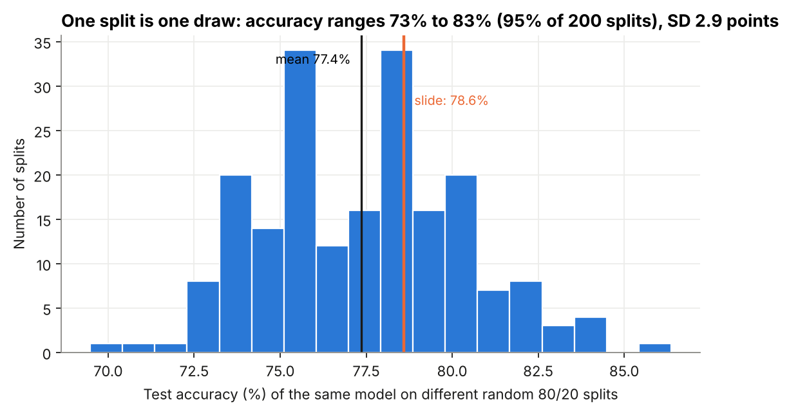
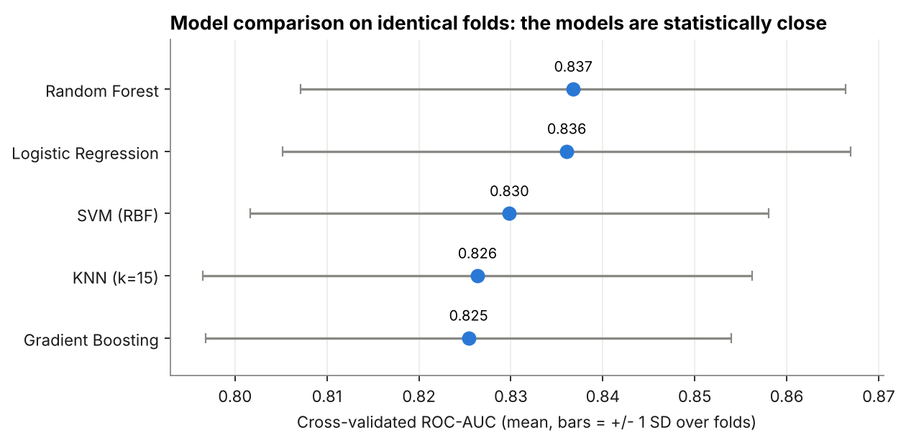
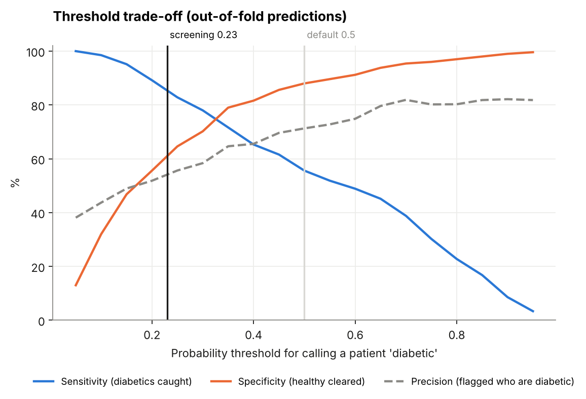
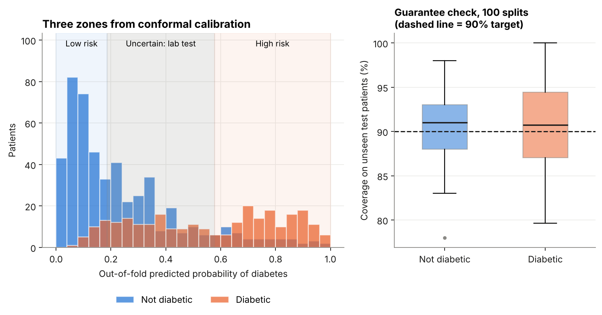
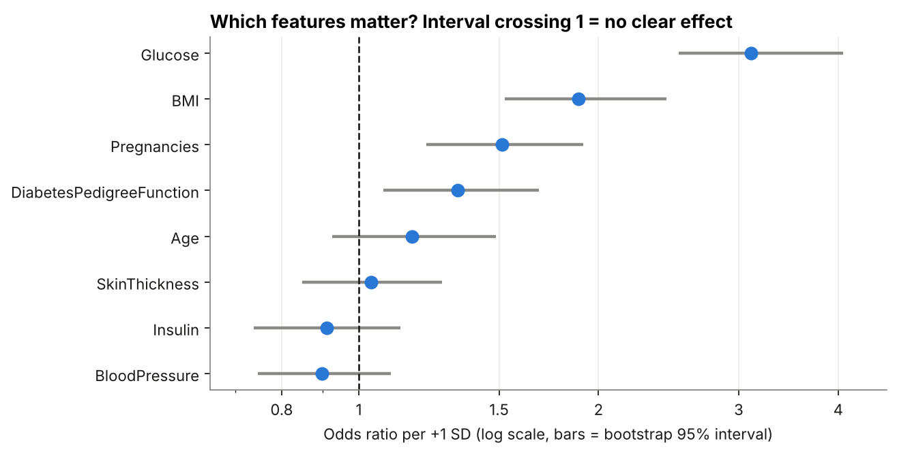
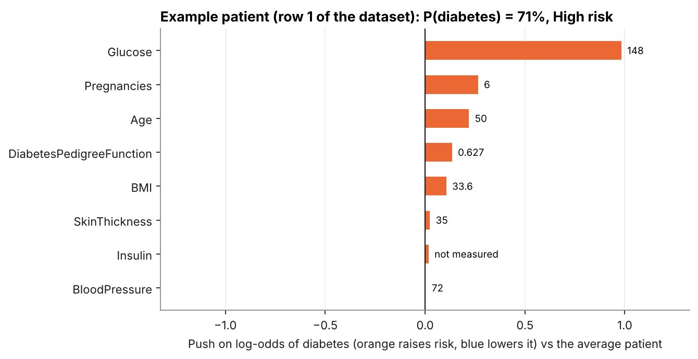
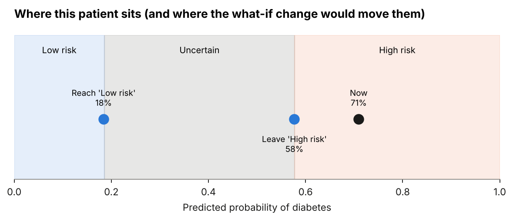

# Diabetes Prediction : A Screening Model That Knows When It Is Unsure

The original project trained standard classifiers on the PIMA Indians Diabetes dataset (Logistic Regression was best, about 78% accuracy). This repository keeps that work as the **baseline** and adds a **trustworthy-screening extension** on top: a model that says *"uncertain, get a lab test"* instead of guessing, explains each prediction, and shows what would have to change to move a patient's risk.

> **Not a medical device.** This is an educational project on a small public dataset (768 women of Pima heritage, age 21+). Nothing here should be used for real clinical decisions.

---

## What is in it

| Part | What it does | Where |
|---|---|---|
| **Baseline** (the original course project) | Original cleaning, Logistic Regression, ROC, forward selection, L1/L2 curves, confusion matrix | `diabetes_ml/baseline.py` |
| **Honest evaluation** | Same experiment on 200 random splits, repeated cross-validation on identical folds for 5 models, a cleaning ablation, age subgroups | `diabetes_ml/evaluation.py` |
| **Calibration + screening threshold** | Are the probabilities honest? Which threshold catches 85% of diabetic patients? | `calibration.py`, `thresholds.py` |
| **Conformal prediction** (new) | Answers *High risk*, *Low risk* or *Uncertain*, with a per-class coverage guarantee | `conformal.py` |
| **Explanations** (new) | Exact per-patient feature contributions and bootstrap odds ratios | `explain.py` |
| **What-if analysis** (new) | Smallest change in glucose / BMI / blood pressure that moves the model's answer | `counterfactual.py` |
| **Web demo** (new) | Enter a patient, get the answer, the reasons and the what-if | `app/streamlit_app.py` |

---

## Main results

All numbers come from `python scripts/run_all.py` (committed in `results/`).

### 1. The headline number from one split is not stable

The original recipe on a single 80/20 split gave 78.6% accuracy. Repeating the identical experiment on 200 random splits:

| | Accuracy |
|---|---|
| Mean over 200 splits | **77.4%** |
| Standard deviation | 2.9 points |
| 95% of splits fall between | 72.7% and 83.1% |

So 78.6% is a perfectly normal draw, but any single split can land anywhere in a ten-point range. Comparing models by one split is not reliable.



### 2. The five models are statistically close

5 x 5-fold repeated cross-validation, identical folds, leak-free preprocessing (mean +/- SD over 25 folds):

| Model | ROC-AUC | Accuracy | Sensitivity (recall) |
|---|---|---|---|
| Random Forest | 0.837 +/- 0.030 | 76.4% | 59.6% |
| **Logistic Regression** | **0.836 +/- 0.031** | 76.8% | 55.7% |
| SVM (RBF) | 0.830 +/- 0.028 | 76.1% | 54.8% |
| KNN (k=15) | 0.826 +/- 0.030 | 75.8% | 56.7% |
| Gradient Boosting | 0.825 +/- 0.029 | 75.8% | 61.1% |

The gaps (about 0.01 AUC) are much smaller than the fold-to-fold spread (about 0.03). The honest conclusion is that on this dataset the model choice barely matters, so the simple, interpretable Logistic Regression is the sensible one. The extension is built on it.



### 3. At the default threshold the model misses nearly half of diabetic patients

Out-of-fold predictions for all 768 patients with Logistic Regression:

| Threshold | Sensitivity | Specificity | Precision | Diabetics missed |
|---|---|---|---|---|
| 0.50 (default) | **55.6%** | 88.0% | 71.3% | 119 of 268 |
| 0.23 (chosen for screening) | **86.6%** | 62.2% | 55.1% | 36 of 268 |

For screening, a missed diabetic is worse than a false alarm, so the threshold should not default to 0.5. (The confusion matrix on the original slides shows the same pattern: 26 of 52 diabetic patients missed.)



### 4. The new part: "High risk", "Low risk" or "Uncertain"

Class-conditional conformal prediction (target: at least 90% of each class gets the right label inside the answer set). Checked over 100 random 80/20 splits, calibrating on the training part only:

| Check | Result |
|---|---|
| Coverage of non-diabetic patients | 90.6% on average (target 90%) |
| Coverage of diabetic patients | 90.7% on average (target 90%) |
| Answer is *Low risk* | 38.1% of patients |
| Answer is *High risk* | 23.8% of patients |
| Answer is *Uncertain* (send for lab test) | 38.1% of patients |
| Accuracy when the model does commit | **84.9%** (versus 76.8% overall) |

The model is right more often exactly when it chooses to answer. The cost is that about 38% of patients get *Uncertain*, which is realistic for a dataset where glucose alone separates the groups only partly.



### 5. What drives the prediction

Odds ratio per +1 standard deviation (bootstrap 95% interval):

| Feature | Odds ratio | 95% interval |
|---|---|---|
| Glucose | 3.11 | 2.52 to 4.05 |
| BMI | 1.89 | 1.53 to 2.43 |
| Pregnancies | 1.51 | 1.22 to 1.91 |
| Diabetes pedigree function | 1.33 | 1.07 to 1.68 |
| Age | 1.17 | 0.93 to 1.49 (not clearly different from 1) |
| Skin thickness, insulin, blood pressure | 0.90 to 1.04 | all cross 1 (no clear effect) |

Glucose does most of the work; forward selection tells the same story (a glucose-only model already reaches AUC 0.79, and four features reach 0.83).



### 6. A worked example

Row 1 of the dataset: P(diabetes) = 71%, answer *High risk*. The model's smallest what-if changes:

| Goal | Change | New probability |
|---|---|---|
| Stop being *High risk* | Glucose 148 -> 136.1, BMI 33.6 -> 32.1 | 58% |
| Reach *Low risk* | Glucose 148 -> 99.5, BMI 33.6 -> 27.4 | 18% |




---

## Things this project found that you might not expect

* **Fixing the hidden missing values barely changed accuracy.** In PIMA, a 0 in Glucose, Blood Pressure, Skin Thickness, Insulin or BMI means "not measured" (48.7% of insulin values and 29.6% of skin thickness values). Treating them properly raised AUC from 0.830 to 0.836, which is smaller than the noise (SD 0.03). It is still the correct thing to do, but it is not where the gains are. See `results/tables/06_preprocessing_ablation.csv`.
* **The original cleaning leaked a little.** Filling missing values with the mean of the *whole* dataset before splitting lets test rows influence training. The extension imputes inside each cross-validation fold instead. The measured effect was small here, but the habit matters.
* **Calibration was already fine.** Logistic Regression's probabilities track the observed rates well (expected calibration error 0.043; Random Forest raw 0.027, sigmoid-calibrated 0.037). Calibrating gave no clear gain, so none is applied.
* **Performance falls with age.** AUC is 0.86 for ages 21-29 but 0.74 for 50+, and sensitivity at 0.5 is only 45% in the youngest group. The groups are small (89 to 396 patients), so read this as a warning, not a measurement.

---

## Limitations (please read)

* **Small, old, narrow data.** 768 women of one population, collected decades ago. Results will not transfer to other groups without re-validation.
* **Association, not causation.** The what-if analysis describes what the *model* learned. It does not prove that lowering a number would change a person's health.
* **The coverage guarantee is on average.** Over many splits coverage averages 90.6% / 90.7%, but a single small test set can fall lower (the worst of the 100 splits was about 78% for non-diabetic and 80% for diabetic patients).
* **A large share is sent for follow-up.** Because 90% of diabetic patients must be kept inside the answer set, 62% of patients get *High risk* or *Uncertain* (precision of that group is about 51%). That is the price of the guarantee on this dataset.
* **Not validated clinically.** No external test set, no prospective study.

---

## Repository layout

```
diabetes-trustworthy-screening/
├── README.md
├── LICENSE
├── requirements.txt
├── data/
│   ├── diabetes.csv          # PIMA dataset (768 rows)
│   └── README.md             # source, columns, the hidden-zeros problem
├── diabetes_ml/              # the package
│   ├── config.py             # constants, column names, what-if limits
│   ├── data.py               # loading + validation
│   ├── preprocessing.py      # leak-free pipeline (zeros -> NaN, median fill, scaling)
│   ├── baseline.py           # the original course project, reproduced
│   ├── evaluation.py         # model comparison, ablation, age subgroups
│   ├── calibration.py        # reliability, Brier, expected calibration error
│   ├── thresholds.py         # threshold table, sensitivity-targeted threshold
│   ├── conformal.py          # class-conditional conformal prediction
│   ├── explain.py            # contributions, odds ratios, importance
│   ├── counterfactual.py     # smallest what-if change (exact solution)
│   ├── screening.py          # ScreeningModel: everything together
│   └── plots.py              # all figures
├── scripts/run_all.py        # reproduces every table and figure
├── app/streamlit_app.py      # the demo
├── tests/                    # 32 tests (pytest)
├── results/
│   ├── figures/              # 14 PNG figures
│   ├── tables/               # 12 CSV tables
│   └── metrics.json          # every number quoted above
└── .github/workflows/ci.yml  # runs the tests on every push
```

---

## Quick start

Needs Python 3.10 or newer.

```bash
# 1. get the code and enter the folder
git clone https://github.com/<your-username>/diabetes-trustworthy-screening.git
cd diabetes-trustworthy-screening

# 2. create an isolated environment and install
python -m venv .venv
# Windows:      .venv\Scripts\activate
# macOS/Linux:  source .venv/bin/activate
pip install -r requirements.txt

# 3. reproduce every figure and table (about 2 minutes)
python scripts/run_all.py

# 4. run the tests
python -m pytest -q

# 5. open the demo in your browser
streamlit run app/streamlit_app.py
```

Use the model from your own Python code:

```python
from diabetes_ml.data import load_pima
from diabetes_ml.screening import ScreeningModel

model = ScreeningModel().fit(load_pima())
result = model.predict({
    "Pregnancies": 2, "Glucose": 150, "BloodPressure": 80, "SkinThickness": 30,
    "Insulin": 0,            # 0 or None = not measured
    "BMI": 34.0, "DiabetesPedigreeFunction": 0.5, "Age": 45,
})
print(result.decision, f"{result.probability:.0%}")   # e.g. Uncertain 52%
print(result.contributions[["feature", "contribution"]])
print(model.what_if({...}, goal="low")["changes"])
```

---

## How the extension works 

**Conformal prediction.** A normal classifier always says "diabetic" or "not diabetic". Here, the model's predicted probabilities for the training patients are collected out-of-fold (each patient is scored by a model that never saw them). For each class separately we find the probability cut-off that keeps 90% of that class's patients on the right side. A new patient then falls in one of three zones: *Low risk*, *High risk*, or in the overlap, *Uncertain*. The guarantee is distribution-free: it needs no assumption about the model being correct, only that new patients look like the training ones. Doing it per class matters because diabetic patients are only 35% of the data and are the ones we must not miss.

**Explanations.** For Logistic Regression on standardised features, the contribution of feature *j* to a patient's log-odds is exactly `coefficient_j x z_score_j`. These are the same numbers a SHAP analysis gives for a linear model, so no extra library is needed. The tests check that `intercept + sum(contributions)` equals the model's output to machine precision.

**What-if.** Minimise the total change (in standard deviations) of glucose, BMI and blood pressure subject to reaching a target probability, never going below healthy floors (glucose 70, BMI 18.5, diastolic blood pressure 60) and never increasing risk. Because the model is linear this has an exact solution (a "water-filling" calculation), and the code verifies the final probability by re-running the model on the changed values.

---

## Reproducibility

* All random seeds are fixed (`RANDOM_STATE = 42`; split-variability and coverage experiments use fixed seed lists).
* `python scripts/run_all.py` takes about 2 minutes; `--quick` runs a reduced version (fewer repeats) for a fast check.
* Tested with scikit-learn 1.9, pandas 3.0, NumPy 2.5, Python 3.13.

## Data and credits

PIMA Indians Diabetes dataset: originally from the National Institute of Diabetes and Digestive and Kidney Diseases. Please cite Smith, J.W., Everhart, J.E., Dickson, W.C., Knowler, W.C., Johannes, R.S. (1988), *Using the ADAP learning algorithm to forecast the onset of diabetes mellitus*, Proc. Symp. on Computer Applications and Medical Care, 261-265. See `data/README.md`.

Original course project: CS 403/603 Machine Learning, Indian Institute of Technology Indore. Extension, tests and demo added afterwards.

## License

MIT, see `LICENSE`. The dataset keeps its own terms (see `data/README.md`).
